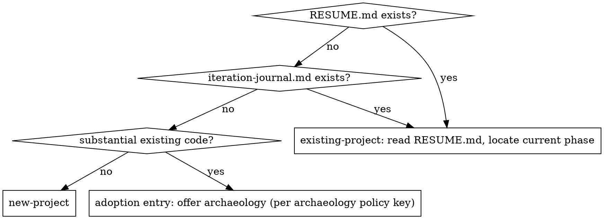

# Project Life Cycle

End-to-end coordinator for traceable, multi-phase project execution. Wraps the existing `superpowers:*` skills with the conventions surfaced during the initial pilot (see `references/origin.md`).

## This skill IS an agent harness

See `references/skill-overview.md` -- the agent-harness framing (how this skill maps onto harness primitives); context, not needed before acting.

## User Cheatsheet (AI: surface this verbatim in chat the first time this skill is invoked per session)

**4 habits to save tokens + keep continuity (translate to user's preferred language when surfacing):**

1. **End of every phase → journal entry → `/clear`**
   - After finishing a phase, have AI write the journal entry (no standalone handoff file — findings/gotchas fold into the journal's FACT schema) + update RESUME.md + commit, then `/clear` before starting the next phase
   - Skipping `/clear` between phases = context accumulates linearly; every subsequent turn gets more expensive

2. **Don't invoke this skill's workflow for trivial tasks**
   - Typo / single-file polish / one-off bug fix / single config tweak → just say "fix this, skip the workflow"
   - The full workflow (brainstorm → plan → 6-step cadence → journal → PR) burns 100-300K tokens per phase
   - Use the skill for: fresh project / new milestone / multi-task feature / decisions needing research

3. **Big lookups go to a subagent, not main context**
   - "Where is X / investigate Y / list all Z / map this directory" → say "use an Explore subagent"
   - Running grep/find/Read chains in main context = context bloat that taxes every later turn
   - Subagent returns a synthesis; main context stays light

4. **Session continuity: the save is automatic — but real decisions still need `/handoff`**
   - Two layers. **Mechanical (automatic):** once `/init-harness` wires it, a `Stop` hook auto-saves a mechanical recap of every session (messages / files / tools) to `~/.claude/plc-session-data/` — no typing. At a context limit, just `/clear`; next session, run **`/catchup`** for a welcome-back card — it reads that recap **plus** your `RESUME.md` and live git (scoped to the current repo, read-only).
   - **Curated (manual):** the auto-recap captures *what you did*, not *why / what-not-to-retry / the next concrete step*. When a session made a real decision or hit a real lesson, run **`/handoff` BEFORE `/clear`** — it writes the curated `RESUME.md`, which the `SessionStart:resume` hook auto-injects next time.
   - Rule of thumb: **trivial pause → `/clear`; real state worth keeping → `/handoff`, then `/clear`.** The mechanical save is a safety net, not a substitute for `/handoff`.

**Bonus — know your own style:** run **`/builder-profile`** any time for a private, on-machine snapshot of how you actually use the agent (descriptive, nothing leaves your machine). Easy to forget it exists — try it once.

**AI MUST surface this cheatsheet to the user the first time this skill loads in any session.** Translate the cheatsheet into the user's preferred language (detect from CLAUDE.md `language` setting or recent user messages) before surfacing — the cheatsheet content is universal, but the user reads it in their own language. After surfacing once, enforce silently via the Mandatory Conventions + Red Flags below.

---

## Core Principle

Every decision, deviation, and review finding must be traceable through git + dated artifacts. Plans always drift; the drift is the most valuable signal — surface it, don't bury it.

**Which of these rules is actually enforced, and which is held up by nothing?** That question has
a written answer: `references/step-enforcement.md` maps every required step to what enforces it —
a close-gate check, a hook, CI, or nothing at all — and separates the rules with no enforcer from
the guards that admit they fail open and from the checks whose real scope is narrower than the
prose around them reads. Consult it before assuming a rule below is backed by code.
<!-- plc-p31:begin -->
## Definition of Done (enforced — read this BEFORE the step lists)

The #1 way this skill fails: the AI finishes the code (the interesting part), feels done, and silently skips the wrap-up — journal, tests-3×, handoff, CHANGELOG, PR-comment. Those are the LAST steps, furthest from attention once code works. Prose "MANDATORY" does not stop this. **Two forcing functions do, and both are required every time:**

1. **Materialize the steps as an enumerated task list — FIRST action on every invocation, before any work.** For the current entry that means: per-phase work → the 11 per-phase steps; a single cadence task → the 6 cadence steps. **Enumerate every step as its own item — never collapse them into one "do the work" item, and never just announce the count in prose.** The wrap-up items (journal / tests-3× / handoff / CHANGELOG / PR-comment / smoke) are **non-optional**, never dropped from the list. Visible unchecked items at done-time are the cheapest defense against silent skips. Mark each in-progress → completed as you go; never batch. ❌ Anti-pattern: saying "this is a 6-step process" and then running with no list emitted — or emitting a single "implement the feature" item. Both defeat the tracker; the wrap-up steps silently drop.

   **Two ways to satisfy it — the file is the contract, the host tool is the upgrade.**
   - **Portable (always available):** write **`.claude/tasklist.md`** — one `- [ ]` line per step, wrap-up steps included, with the nonce line the guard prints in its block message as the first line. This works on every host, because writing a file is the one capability any agent that can edit code necessarily has. **Add `/.claude/tasklist.md` to the project's `.gitignore`** — it is per-phase working state carrying a session nonce, and committing it puts a meaningless artifact in every adopter's history. Expect **exactly one block per phase**: the nonce is minted by that block, so the artifact cannot be pre-written to avoid it.
   - **Host-native (better when present):** a first-class task tool — Claude Code's `TaskCreate` (one task per call, `TaskUpdate` to advance them), or the equivalent under another CLI (`update_plan`, `write_todos`, `updateTodos`, `todo_write`). Where one exists, prefer it: it renders as live UI rather than a static file.

   **In-progress marker (`- [/]`).** The list is markdown checkboxes: `- [ ]` todo, `- [x]` done, and **`- [/]` for the ONE task in progress right now** — the `[/]` convention is the Obsidian-Tasks de-facto in-progress status (ASCII, stays in the checkbox family, so the tasklist file itself stays pure-ASCII; the display glyph is a rendering-layer concern, never stored). Set `- [/]` on the leaf you are working so anything reading the file can tell which step is live. Any unknown checkbox char is treated as todo. **There is no reader command.** PLC shipped one — `/tasklist`, a pure-bash terminal renderer — and a later change removed it after it was found unused. The CONTRACT is what the skill teaches and what the hook enforces; a renderer for it is a host affordance, and the file is plain markdown that any editor, `grep` or host widget already shows. Removing the reader changed no byte of `.claude/tasklist.md` and no part of this contract.

   `hooks/tasklist-first.sh` checks the **file**, and accepts a host tool call as an alternative satisfier. It deliberately does **not** key on a tool name: a hook cannot enumerate the session's tools, and no two CLIs agree on the name or the call granularity — so a name-keyed guard is unsatisfiable on some hosts and reports enforcement it is not performing. When it cannot verify a list it says **`UNVERIFIED`** on every gated call rather than going silent; an `UNVERIFIED` line in the transcript is **not** a pass, and closing a phase under one requires a `SKIP: <reason>` line in the journal like any other unperformed step.

2. **Run the close gate — and paste its output — before claiming done.** Run `bash scripts/close-gate.sh task X.Y` after each cadence task and `bash scripts/close-gate.sh phase X.Y` before opening the PR. (`/init-harness` scaffolds `make task-done` / `make phase-done` wrappers around exactly these commands, so on a bootstrapped adopter repo the `make` form works and is the documented entry point. Use whichever form your repo actually has; the gate behaves identically.) The gate is pure code and exits non-zero when a required artifact is missing. **It checks exactly these fifteen things, and nothing else** — anything not on this list is model discipline, not enforcement. **This table is pinned to the gate's own `cs()` call sites by the `skill-checkset-matches-gate` invariant** — neither side is a literal, so it cannot silently drift again. *It drifted before: this table said "eight" while the script ran twelve, and an external agent planned an entire wiring scheme off that sentence and got every coordinate in it wrong.*

   | # | Check | Mode |
   |---|---|---|
   | 1 | the phase diff touched the product tree | task + phase |
   | 5 | newest journal fragment: exists, fresh, FACT fields, "Plan deviations" header | task + phase |
   | 7 | test-evidence unchanged since it was **generated** — by declared-input fingerprint when configured, else by mtime. **Not proof a test ran** | task + phase |
   | 8 | declared repo-integrity invariants | **every branch, always** |
   | 9 | `validator_input_paths_rationale` — the manifest carries the argument for narrowing `test_evidence_inputs`; the kept-count is derived by the gate, the rest is type-checked, never audited | rides with 7 |
   | 10 | `ac-oracle-binding` — every acceptance criterion has a runnable oracle or a still-true written-down exclusion | task + phase |
   | 2 | `CHANGELOG.md` `[Unreleased]` touched in range | phase only |
   | 3 | a spec doc exists for the phase (`phase_docs_glob`) | phase only |
   | 4 | a plan doc exists for the phase (`plan_glob`) | phase only |
   | 6 | `docs/ROADMAP.md` names the phase and was touched since the branch point | phase only |
   | 9b | divergence records — held OFF the push path deliberately (measured: git holds the connection open for the whole pre-push hook) | phase + CI |
   | 11 | `closure-declaration` — the phase declares which backlog ids it closed, reconciled against the ledger. Armed by the manifest | phase only |
   | 13 | `sidelines` — a captured side discovery carries a landing. `task` checks WELL-FORMEDNESS only (every item line opens with a recognised state token; a missing file is fine, because requiring a drain on the push path would make capturing one line block the next push). `phase` requires the file to EXIST (an absent gitignored queue is not an empty one), `untriaged` to be empty or `- [none]` present, every `refused` to carry its `class:` and every `declined` its `why:`. Armed by the `sidelines` manifest key, read at the check-set so an unarmed adopter is printed as SKIPPED. **Reads declarations only — it cannot see a discovery nobody wrote down** | task + phase |
   | 12 | `experiment-gate` — a proposal exists for the phase, or a categorised skip is recorded. **Existence and structure only; it cannot judge a hypothesis** | phase only, armed by policy |
   | 14 | `ui-mock-contract` — a UI-changing phase carries a confirmed-mock artifact link + a checked user-confirmation marker + an inline image embed in the story/spec. **Presence only — it verifies the link, the checked box and an image reference exist, never that the user actually confirmed (human marker)** | phase only, armed by `ui_change:true` |
   | 15 | `story-driven-smoke` — the Track A manual smoke names every `user-story.md` AC id. **Presence only — it verifies each AC is named, never that the step walked the UI correctly (human smoke run)** | phase only, armed by `smoke_a_glob` |

   **Not checked by the gate, despite being required by this skill:** `user-story.md`, Track A/B smoke artifacts, the acceptance verifier, ADR, cognition capture, and the *shape* of the test evidence (the gate fingerprints the file; it cannot tell a 3x suite from a single run). **"It passed" without pasted gate output = unverified = not done.** Full spec, portable script, manifest, and pre-push-hook wiring in `references/close-gate.md`. **The strongest layer is the active git pre-push hook** (`.githooks/pre-push` + `git config core.hooksPath .githooks`) — it rejects pushing an incomplete `feat/phase-*` branch regardless of whether the model remembered to run the gate. It is **not un-bypassable**: `git push --no-verify` skips every pre-push hook, which is a fact about git that the hook's own source states. What makes it strong is that skipping it takes a deliberate, visible act rather than a forgotten step. The only layer nothing local can bypass is **branch protection on the forge**, because it is enforced server-side after the push. Model-run discipline alone is the weakest layer and is exactly what lets wrap-up (especially the tests) get skipped. **Before relying on the gate, confirm a pre-push gate is actually active — check BOTH wirings, not just one:** either `git config core.hooksPath` prints a hooks dir that contains the gate (husky/lefthook style), OR the default `.git/hooks/pre-push` exists and invokes the close gate (what `scripts/install-close-gate-hook.sh` installs). An empty `core.hooksPath` is **not** proof the gate is absent — a repo can run its gate from the default `.git/hooks/pre-push` with `core.hooksPath` unset. Only if NEITHER holds is the gate uninstalled — run `/init-harness --refresh` (or `scripts/install-close-gate-hook.sh`) to retrofit it.

**A task/phase is "done" only when every wrap-up todo is checked AND the close gate exits 0 with output shown.** A skip is legitimate only when written down as a `SKIP: <reason>` line (journal "Plan deviations") — the gate enforces this. No silent skips.

<!-- plc-p31:end -->
## When to Use

- A fresh repository ("let's start a new project") → branch to "new-project" entry
- An existing repository with `RESUME.md` (root or `docs/`) / `iteration-journal.md` (`docs/` or root) → branch to "existing-project" entry — either anchor at either location counts
- An existing codebase with substantial code but NO plc artifacts ("brownfield") → branch to "adoption entry": offer the archaeology pass per `references/archaeology.md`
- A milestone is about to start → invoke `superpowers:brainstorming`
- A milestone has a signed-off spec → invoke `superpowers:writing-plans`
- A phase plan is ready → run the per-task cadence below
- A milestone is closing → run the milestone-done gate

**Don't use** for one-off bug fixes, single-file polish, or trivial commits — those don't need the full machinery.

## Entry Detection

"Substantial existing code" = recognized manifest present OR ≥1 recognized source file outside the whitelist. **The decision is runnable — `bash "${CLAUDE_PLUGIN_ROOT}/scripts/archaeology-preflight.sh" detect` answers it and says why** — and the four lists it reads live in one place, not in prose; the shape, ambiguous-case and monorepo rules are in `references/archaeology.md`. Each anchor in the graph counts as present at either conventional location (`RESUME.md` at root or `docs/RESUME.md`; `docs/iteration-journal.md` or root) — see the detection contract. The adoption entry offers a one-time read-only archaeology pass deriving baseline drafts (inferred ROADMAP / glossary / backfilled ADRs / journal start line / RESUME / adoption-snapshot index), gated by the ask-once `archaeology` policy key.

<!-- plc-p31:begin -->
## Per-Phase Workflow

**Front door (runs FIRST, on every fresh user request — milestone kickoff AND mid-phase ad-hoc instructions like "now fix this modal"):** pass the request through the intent-gate (`references/intent-gate.md`) — **classify → confirm intent → reframe+sharpen** — before any code. Default `assume` (lay out assumptions for one-tap approve; ask one question only when a key ambiguity can't be assumed). The gate's size classification is also the **machinery triage**: trivial+clear → one-liner inline (skip the workflow); medium → per-task cadence; large → the brainstorm below. For large work the **confirmed intent seeds step 1's brainstorm — never re-asked downstream**. The gate also infers an **Archetype** (Builder default / Prototyper / Sweeper / Grower / Maintainer) — orthogonal to Size: Size picks *how much* ceremony, archetype picks *what shape* the chain takes (which cadence steps fire, default oracle, diff direction). Per-request + one-tap confirm (never frozen into a box); Sweeper's net-negative-LOC direction is the one deterministically gated delta. See `references/intent-gate.md` §"Archetype". Skip only on an already-precise prompt or a verbal "skip gate".

For each milestone:

1. **Brainstorm** → `superpowers:brainstorming`, seeded by the intent-gate's confirmed intent (continue from it, never re-ask). Runs the **mandatory 7-step per-question protocol** (frame → parallel research → 1st rec → blind 2nd-agent → compare → evidence-strength tag → surface): research is not optional per decision, every locked decision carries ≥1 citation, decisions are ordered dependency-first, and **mode choice (A interactive / B batch) is asked at kickoff** — the full loop, the two-state `PROPOSED | LOCKED` entry, the blind agent's required structured fields, the language-first sub-pass, and the mandatory recording rules all live in `references/brainstorm-research-protocol.md` (do not re-derive here). Storage: append Q&A to the branch's `docs/qa-log.d/<date>-<branch-slug>.md` fragment (fragment convention → `references/retention.md`) and produce the per-phase design spec under `docs/superpowers/specs/`. **User-story file is mandatory for any user-observable phase** — write it BEFORE the spec, user signs off (numbered ACs + Out-of-Scope), THEN spec; it is ground truth for the acceptance verifier + validator (`references/user-story.md`; skip only for pure-refactor / dep-bump / docs / internal-tooling). **For a UI-changing phase, build a mock → user confirms it → embed the confirmed-mock artifact link in the story/spec BEFORE sign-off** — the mock is the UI contract the builder implements and diffs against, not the prose; "approved-in-concept" words are not confirmation. Enforced by the gate's `ui-mock-contract` check (armed by `ui_change: true`); the expected story/spec shape — a mock link on a Mock / UI Contract line plus a checked `- [x] … confirmed … mock` marker — is in `references/close-gate.md`. Also fronting the brainstorm, each with its reference: glossary discovery before Q1 (`references/context-md.md`), optional PRD for non-engineer stakeholders (`references/prd-template.md`), an ADR offer for decisions passing the 3-criteria gate (`references/adr.md`), HTML-companion opt-in (`references/output-format.md`), non-technical repo-intake (`references/repo-intake.md`), and gated reference-share capture (`references/references-log.md`).
2. **Research gate** → for any decision matching the triggers in `references/research-gate.md`, do online research first; cite sources in the spec.
3. **Spec ↔ Q&A cross-check (agent A)** → at brainstorm close, dispatch an independent **read-only** cross-check agent per `references/reviewer-brief.md` §"Cross-check lens" sub-mode A: does the spec faithfully reflect every locked decision — any lock missing, contradicted, or silently widened? (NOT a design review — it may not re-litigate a locked choice.) This **absorbs the former writer self-review**: agent A also names ≥2 failure modes per major decision into each entry's `Risks (what could go wrong with this choice)` field, tagged `cross-check agent A` — the spec's risks are no longer self-graded by its writer. Inputs: the `docs/qa-log.d/*.md` fragment + `user-story.md` (if any) + the `-design.md` spec.
3.5. **Experiment proposal** → for any change that moves a **measurable behaviour** (accuracy, recall, latency, cost, a quality the user can perceive), write the nine-section proposal per `references/experiment-gate.md` and confirm it with the user BEFORE planning. The spec says what to build; the proposal says how we will know it worked; **only then can the plan schedule the work of building the measurement** — placed after step 4 it sits outside the plan and is the first thing squeezed out. It also has to be a spec item by the time step 4's plan↔spec cross-check (agent B) runs, or that check cannot demand a plan step for it. **Not every phase needs one, and a proposal demanded on every phase is a rubber stamp** — Section D's triggers say when to skip (pure rename / docs / formatting / dependency bump / equivalent rewrite), the one-sentence test is *can you write "changing X improves Y"?*, and a skip is recorded in the journal as `SKIP: experiment-proposal — <category>` so that deciding-not-to and never-considering-it stop producing identical repository state. Gated by the `experiment-gate` policy key (`required | ask | off`; absent key = the check does not run). `/experiment` walks the proposal section by section.

4. **Plan** → `superpowers:writing-plans`. Output: `docs/superpowers/plans/YYYY-MM-DD-phase-N-<slug>.md`. **Plan ↔ spec cross-check (agent B)** → after the plan lands, dispatch the cross-check lens sub-mode B (`references/reviewer-brief.md`): bidirectional coverage — every plan step traces to a spec item AND every spec item is covered by a plan step (orphan steps and uncovered items are both findings). Independent read-only agent, same fresh-context dispatch as agent A. **Spec finalization HTML re-opt-in** — if user declined the HTML companion at step 1 but now wants to share locked spec with stakeholders, re-ask once: "Generate HTML stakeholder view of locked spec? (renders mockups + dataflow + evidence-strength tags)". Skip if `html-policy` is set in `CLAUDE.md` or if already accepted at step 1.
5. **Branch + execute** → cut a phase-scoped branch (`feat/phase-X.Y-<slug>`, never push direct to main). Use the per-task cadence in `references/cadence.md` (6 steps: implementer [1] → background batch: acceptance verifier [1.5] ∥ code-quality review [3], validator [2] joining on the verifier report → fixup [4] → journal entry [5], per `references/cadence.md` §"Background-by-default"). **One task = one commit; push immediately, no batching.** **Bug encountered during execution** → invoke `references/diagnose-loop.md` (8-phase, 0–7: consult lessons → feedback loop → reproduce → falsifiable ranked hypotheses → instrument → fix + regression test → cleanup → distill); Iron Law = no fix without root cause. When the intent gate flagged the request as a **bug** and the user accepted its offer, run the loop inside the **behavior-locked debug session** (`references/debug-session.md`) — lock the neighbors as PRESERVE rows first, then tier any incidental findings (`references/findings-tier.md`), then prove the fix is fail→pass and every neighbor pass→pass; offer-not-auto, on decline the ad-hoc loop above. **Issue-tracker projects** may insert Step 4b breakdown: split the plan into vertical-slice tracer-bullet issues w/ HITL/AFK labels per `references/issue-breakdown.md`; skip if phase is owned end-to-end by single agent.
6. **Dual-track smoke** → write Track A manual checklist + Track B Playwright (or equivalent) spec. Both required for any user-visible phase. **Track A is story-driven — it names every `user-story.md` AC id and walks it in the real UI, and the plan's verify step references it** (walking the story in the UI is part of verification, not only unit + Track B). See `references/smoke-tracks.md`.
7. **Phase delivery handoff** → **no standalone file.** The one section that is not derivable — §7 *findings / gotchas* — goes into the journal fragment under the FACT schema (`references/journal-schema.md`). The other seven sections are caches: the file index is in git, the tests are in the test run, the PR-body appendix is on GitHub. Findings tier S1/S2/S3 per `references/findings-tier.md` still applies — it just lands in the journal. (`references/handoff-template.md` is retained for the §7 field definitions and the PR-description appendix; it no longer names an output file.)
8. **PR + Track A smoke + CHANGELOG update** → write the PR body: a mandatory plain-language **TL;DR** at the very top, ABOVE §1 (zero-jargon, four bullets — Problem / What we did / Why we did it / Result + honest boundary), then the **mandatory 3-section format** (§1 What was done — prose intro FIRST, then a `### Use cases` subsection REQUIRED for any new user-facing surface, then file bullets; §2 Why this approach; §3 Requirements satisfied). The full body shape, the Use-cases rule, and the **demo-console-output** requirement (verbatim `cmd 2>&1 | tee` for console/CLI/log/REPL phases) are in `references/handoff-template.md` §"PR description appendix" + §"Demo — real console output". **CHANGELOG `[Unreleased]` entry REQUIRED in the same PR** for any user-visible change — one Keep-a-Changelog category + **exactly one PR label** from the taxonomy (fragment-adopting projects write `changelog.d/<date>-<branch-slug>.md` instead); the label list, exemptions, and full discipline are in `references/changelog.md`. **Smoke interaction mode** (Mode A self-serve / Mode B guided) is asked once per phase unless `smoke-mode` overrides — the modes + the ask are in `references/output-format.md`, the Track A checklist in `references/smoke-tracks.md`.
9. **CI gate + review (try-first-then-fallback)** → **always attempt the default path first**: push the branch, let the configured CI workflow run, then post `@copilot review` once CI is green. **The sole review gate on every path is the independent general-purpose reviewer's computed verdict** (`references/review-record.md` §"Termination contract"); Copilot is **advisory** and a Copilot object of any shape never produces a PASS. **Default path:** (a) CI runs all gates (type / lint / unit / integration / regression / e2e / coverage / security per `references/ci-cd-gates.md`); (b) Copilot inline review (advisory) per `references/copilot-review-loop.md` — fixup commit + per-finding inline reply with SHA + Fx-label + re-trigger until clean. **Fallback path (Pattern E) is automatic when:** either the CI workflow fails to start due to "GitHub Actions payments have failed / your spending limit needs to be increased" (account-level billing block) OR Copilot's review job aborts with the same billing error. When that triggers, switch the workflow to `on: workflow_dispatch` dormant (do NOT delete it), run the 3×-green gate locally, dispatch an independent general-purpose reviewer (briefed per `references/reviewer-brief.md`) as the review gate — Copilot being advisory, this is the actual reviewer on every path, not a substitute for one — and **post the full 3×-green + reviewer evidence as a PR COMMENT** (not buried in the PR body). Full Pattern E protocol + decision flow in `references/ci-cd-gates.md` §Pattern E + `references/copilot-review-loop.md` §Copilot stand-in. Skip the (advisory) Copilot loop freely when (i) docs-only PR, (ii) one-line trivial fix not touching security/state/DB, or (iii) the user says "skip Copilot" with a reason in the PR body — but **never skip the independent reviewer**, whose findings must derive to APPROVED-CLEAN (zero open CRITICAL/IMPORTANT — computed by the controller per `references/review-record.md`, never a reviewer-stated approval) before merge.
10. **Milestone-done gate** → **run `bash scripts/close-gate.sh phase X.Y` and paste its output BEFORE opening/merging the PR** — in phase mode the gate verifies the four task-mode checks plus a CHANGELOG `[Unreleased]` touch, a spec doc, a plan doc, and a ROADMAP row naming this phase; non-zero exit = phase not done (`references/close-gate.md`). **It does not verify `user-story.md`, smoke artifacts, or one journal entry per task** — it reads the newest journal fragment, not one per task. Those three remain required by this skill and unenforced by the gate, so they are exactly the steps most likely to be silently dropped. Then see `references/milestone-done.md`. **Update `docs/ROADMAP.md`**: flip the finished milestone to ✅, next to ▶, log scope changes under "Plan changes", and rotate the status-file ring in the same edit (active + 2 most recent closed; oldest moves verbatim to the archive with a pointer stub) — per `references/roadmap.md`. The milestone-close **archival drain + distill** (journal/monolith verbatim moves, 4× roll-over, warn-only hot-cap + coverage rows at `phase-done`, human one-tap promotions → CONTEXT.md/ADR) runs here per `references/retention.md`. Opt-in / non-technical seams fire here too, each with its reference and skipped under `audience: technical`: an HTML milestone-summary opt-in (`references/output-format.md`), a GitHub re-offer (`references/repo-intake.md`), and — at the project's TERMINAL milestone only — a deploy offer (`references/deploy.md`).

## Per-Task Cadence (6 steps)

See `references/cadence.md` for full detail. **The verification tail (steps 1.5 → 2 ∥ 3) is background-by-default**: acceptance verifier + code-quality review dispatch as background agents at implementer-return, the validator joins when the verifier report lands, and the controller blocks only at the fixup step (the first point that needs both reports) — never at dispatch. See `references/cadence.md` §"Background-by-default". Short version:

1. **Dispatch implementer subagent(s)** with the task text + ACs this task closes + scene-setting context + the story's Contingencies section verbatim (pre-declared "when X → do Y" responses — builder follows the pre-decided action instead of escalating; only undeclared surprises go BLOCKED/NEEDS_CONTEXT). **Cross-layer phases split into 1a backend-builder + 1b frontend-builder** per `references/builder-split.md` (folder-scoped tools, sequenced BE→FE, BE emits API-contract summary, FE consumes it; mismatch routes back to BE, never silently massaged client-side). Controller adds explicit "adapt to existing patterns" guidance + first-of-its-kind infra detection. **Soft time budget in every implementer brief**: task exceeding ~15 min of work → STOP, return SPLIT_PROPOSED (done-so-far kept UNCOMMITTED + proposed vertical slices) — report-back, not kill; and the controller **pre-splits** tasks whose plan text predicts >1 file-cluster before dispatch. See `references/cadence.md` §Step 1.
2. **Acceptance verifier (step 1.5)** — independent read-only-on-`src/` subagent writes one acceptance test per AC in `user-story.md`, exercising the system from outside (HTTP / UI / observable side-effect). Reports per-AC pass/fail/untestable. Failed AC → routes to BE or FE builder; untestable AC → spec gap surfaced to user. Skip only when `user-story.md` was skipped (pure-refactor / docs / infra).
3. **Validator (step 2)** — independent **read-only** subagent compares diff against `user-story.md` + spec + Builder Summaries + Acceptance Verifier Report. Outputs Critical/Important/Minor with file:line. Never edits, never invents issues, never does code-quality (that's step 3). Lens: correctness-vs-promise + scope drift (over-build + under-build) + folder boundary + security gaps vs spec.
4. **Code quality review (step 3)** — independent subagent — design, security, a11y, perf, **bloat-smell checklist**, forward-looking impact on downstream tasks.
5. **Fixup commit (step 4)** (separate from the original `feat(...)` commit, never amend or squash). Triage findings via `references/defer-vs-fix.md`. **Re-verification after the fixup is selective at task level** — re-run only the verifier scopes the fixup diff touched (affected ACs / affected folder-map side); `phase-done` still demands the full suite, which is the safety net. See `references/cadence.md` §"Selective re-verification after fixup".
6. **Journal entry (step 5)** (separate `docs:` commit) using the 6-section schema in `references/journal-schema.md`. **Then run `bash scripts/close-gate.sh task X.Y` and paste its output** — in task mode the close gate (`references/close-gate.md`) verifies a product-tree change, the newest journal fragment's FACT fields + "Plan deviations" header, test-evidence whose fingerprint matches the tree, and the declared invariants. **It does not scan for orphan `[DEBUG-` logs** — clearing those is the diagnose-loop's cleanup phase (`references/diagnose-loop.md`), enforced by nothing but the model. Gate exits non-zero = task not done; fix the missing artifact, do not proceed. **Human-approval timing is governed by the `close-gate` policy key** (`per-task` default | `pr-boundary`): projects that adopt a human-blocking close approval (Task Close Report awaiting the user's "ok") may move that blocking approval from every task close to once per PR/merge — an independent read-only reviewer subagent does the per-task read, reports are still written every task, the deterministic gate is unchanged, and the merge boundary MUST keep a human-written approval marker the AI cannot author. See `references/close-gate.md` §"Approval timing".

**Cadence compression** — for trivial mechanical tasks (small diff, no new logic, no security/compliance surface), skip acceptance verifier + merge validator with code-quality review into one pass. Single implementer (no BE/FE split) on layer-pure work. See `references/cadence.md`.

**Comprehension co-discovery (opt-in `comprehension:` key)** -- anti-cognitive-offloading round; see `references/skill-overview.md` + `references/comprehension-co-discovery.md`.

**Builder profile (opt-in `/builder-profile`)** -- local working-style snapshot; see `references/skill-overview.md` for the blurb and `references/builder-profile.md` for the full spec.

## Mandatory Conventions

### Commits & branching
See `references/conventions.md` section Commits & branching for the full commit/branch rules.

### Versioning, CHANGELOG, and release notes
See `references/conventions.md` section Versioning for the CHANGELOG/SemVer/release-notes rules.

### Documentation & traceability
See `references/conventions.md` section Documentation & traceability for the full traceability rules.

### Documents record moments, never states

See `references/conventions.md` section Documents record moments for the derivable-vs-not rule.

### Parallel work & multi-session discipline
See `references/conventions.md` section Parallel work for the WIP=1 + sidecar + single-writer rules.

### Reviews
See `references/conventions.md` section Reviews for the full review rules.

### Smoke & delivery
See `references/conventions.md` section Smoke & delivery for the full smoke/delivery rules.

### Output format & smoke interaction
See `references/conventions.md` section Output format for the MD-canonical rule, HTML-companion opt-in, and the full CLAUDE.md policy-key list.
- **Also `mode: fast | detailed`** (default: unset — identical to a project that never heard of the key, which is what `detailed` names). A **preset**, never a mechanism: it expands into the low-level keys above via one declarative map, every behaviour it changes has its own key that can be turned on its own, and an explicitly set low-level key always beats the preset. It never touches `intent-gate` or `second-agent-family`. Both modes emit the same artifacts; a step the mode skipped keeps its heading and gets a fixed two-line marker. See `references/mode.md`
- **And `careful-paths: <comma-separated git pathspecs>`** (default: unset) — the exception channel out of `fast`. When a task's **uncommitted working-tree changes** touch a declared path, or touch one of the three signals that need no declaration (a dependency manifest, a migration directory, deploy or CI config), that task's verification tail runs at `cadence: full` and says which rule fired. It upgrades **`cadence` and nothing else**. Resolve with `bash skills/project-lifecycle/hooks/plc-careful-check.sh --claude-md CLAUDE.md`. **It does not claim to find every risky change** — the list is marked by you, the signal lists are fixed, the word list is English, and the decision is by path and never by what the change did. All four misses are stated wherever the feature is shown to a person. See `references/careful-paths.md`
- **PR description is markdown-only** — GitHub PR body does not render HTML. Any "richer" PR companion ships as an HTML artifact uploaded to S3 (or similar) with a link in the PR body, not inline HTML.

### CI / CD discipline
See `references/conventions.md` section CI/CD discipline for the full gate rules.

### Self-update (when the user asks to evolve THIS skill)
See `references/conventions.md` section Self-update for the full self-update flow.

### Cost-aware behaviors
See `references/conventions.md` section Cost-aware behaviors for the full cost-aware rules.

## Quick Reference

See `references/quick-reference.md` for the situation-to-action lookup table (a routing index into the sections above).

## Red Flags — STOP

**Before acting, scan the STOP-sign list** -- see `references/red-flags.md` for every Red Flag (the anti-patterns that halt work).

<!-- plc-p31:end -->
## Unattended runs — the runtime is NOT part of this skill

See `references/skill-overview.md` -- the AFK/unattended-run judgment that stays in the skill (eligibility axis, 4-field loop contract, egress policy); the runtime lives in its own repo.

## References

**These files are read on demand — this list is a router, not a digest of them.** Each line says
what its file *decides*; open the file for how.

- `references/intent-gate.md` — workflow front door: classify → confirm intent → sharpen, before brainstorm/cadence. Oracle ladder + machinery triage. Key `intent-gate:`
- `references/init-harness.md` — `/init-harness` spec: stack-detection signal table, per-artifact merge strategy, handler scaffolds, `--refresh`/`--dry-run`, idempotency
- `references/archaeology.md` — brownfield adoption pass: deterministic detection contract, read-only 3-agent fan-out, 6 draft artifacts with provenance, idempotent re-run
- `references/onboarding.md` — Day 1 protocol for a new contributor (human or agent): Q&A-only first day, anchor checklist, why edit-first fails, project-shared commands schema
- `references/verify-loop.md` — give the LLM a way to check its own work: loops A (test) / B (screenshot) / C (curl), where each sits in the cadence, and why no-verify dispatch is self-grading
- `references/ergonomics.md` — Claude Code session ergonomics: the 5 habits, keybindings, continuity, setup commands, `claude -p`/SDK, multi-Claude parallelism rules
- `references/deterministic-handlers.md` — harness-injected pre-step pattern — pure code before the LLM acts, for failure modes with one right answer. 6 handler examples + wiring template
- `references/changelog.md` — Keep a Changelog discipline + PR label taxonomy + per-PR rules + SemVer bump rules + release flow + anti-patterns
- `references/release-process.md` — the `/release` spec: artifact inventory, bump table, per-release file updates, commit/tag conventions, verification, failure recovery
- `references/user-story.md` — mandatory story + numbered ACs for user-observable phases; source of truth for verifier and validator; contingencies + machine-checkable invariants
- `references/builder-split.md` — backend/frontend folder-scoped split for cross-layer phases: `folder-map` schema, per-builder prompts, Builder Summary, BE→FE sequencing
- `references/brainstorm-research-protocol.md` — per-question 7-step loop, mandatory for every brainstorm question. Two-state Q&A (PROPOSED|LOCKED), blind 2nd-agent structured verdict, banned patterns
- `references/context-md.md` — ubiquitous-language glossary discipline: structure, lazy creation, format, the glossary-only boundary, CLAUDE.md pointer convention
- `references/adr.md` — ADR format + the 3-criteria gate (hard-to-reverse AND surprising AND real trade-off). Distinct from phase-scoped spec decisions
- `references/diagnose-loop.md` — 8-phase debug discipline for hard bugs: Iron Law (no fix without root cause), 3-Fix Rule, Phase 0 consult, Phase 7 distill into `docs/lessons.md`
- `references/debug-session.md` — the behavior-locked debug session the intent gate OFFERS on a bug (never auto-start): lock the neighbors as PRESERVE rows first (M1 behavior lock) → `diagnose-loop.md` for root cause → `findings-tier.md` for incidental findings → prove the fix is fail→pass and every neighbor pass→pass. Threads the lock onto the loop; no new script
- `references/prd-template.md` — product-facing user-story synthesis for user-facing phases; complements the engineer-facing spec
- `references/issue-breakdown.md` — optional step 4b: split a plan into vertical-slice tracer-bullet issues with HITL/AFK labels
- `references/document-indexing.md` — TOC convention for long-lived append-only docs: top-of-file H2+H3 index, updated in the same commit as the append
- `references/close-gate.md` — the deterministic forcing function for "done": `task` vs `phase` modes, three wiring layers, the write-down-your-skips rule. Key `close-gate:`
- `references/harness-primitives.md` — verified map of native Claude Code primitives → the skill node each strengthens, with verification provenance. Moves rules from self-discipline to platform
- `references/cadence.md` — the full per-task workflow, including controller responsibilities and compression conditions
- `references/checkpoint-reflow.md` — design-only contract for reflowing prior checkpoint rejections into a fresh spec-writer's dispatch. Hard constraint: no tool-maintained failure scoreboard
- `references/journal-schema.md` — 6-section journal entry template with examples
- `references/research-gate.md` — when online research is required before deciding (trigger list)
- `references/experiment-gate.md` — **per-phase step 3.5**: the nine-section experiment proposal (Hypothesis / Baseline / Dataset / Ground Truth / Metrics / Procedure / Variance / Decision Rule / Cost), the three things that must exist before work starts and who owns each, the three-state Decision Rule (pass / fail / **not-measurable** — without the third, an unresolvable result is forced into "fail" and read as "the change did nothing" when the truth is the scale cannot see it), Section D's triggers for when a proposal is NOT required (a proposal demanded every phase is a rubber stamp) with its closed six-token skip list, the `experiment-gate: required | ask | off` policy key and what the close-gate check does and does not verify, and the instrument-honesty discipline for after it runs — suspect the instrument first, hand-check 3-4 cases before reporting any finding, and the phrasings that are not allowed ("fabricated" → "not found", "no effect" → "not measured").
- `references/retention.md` — hot/cold retention: dual line+KB caps, the milestone-close archival drain, the conflict-free fragment convention across journal/qa-log/CHANGELOG. Key `retention:`
- `references/defer-vs-fix.md` — triage rule for review findings
- `references/milestone-done.md` — closing-the-milestone checklist
- `references/handoff-template.md` — the §7 field format + the mandatory PR body shape (the standalone delivery doc is retired; findings fold into the journal FACT schema)
- `references/smoke-tracks.md` — dual-track smoke contract (A manual + B Playwright)
- `references/findings-tier.md` — S1/S2/S3 triage for findings and known limitations
- `references/cost-aware-behaviors.md` — per-token leverage rules + tool-adopt tiers
- `references/progressive-disclosure.md` — deciding what may leave an ALWAYS-loaded surface. The census script is a reading queue, not a ruler
- `references/ci-cd-gates.md` — pre-commit / PR-time CI / merge-protection gates every project should enforce
- `references/pr-comment-template.md` — the 9-section audit narrative of the PR comment + draft-first workflow + visual capture pattern + N/A skip protocol
- `references/copilot-review-loop.md` — per-PR `@copilot review` loop: trigger format, inline-reply convention, fixup commits, when to skip, stacked-PR caveat
- `references/reviewer-brief.md` — the PLC-native review prompt behind `/review`: read-only dispatch, lens selector, per-language appendices, refute-first with no self-declared verdict
- `references/cross-family-review.md` — the armed-optional cross-family blind 2nd agent: the `second-agent-family` key, 4-gate fail-safe flow, visibility stamps, privacy boundary
- `references/handoff-snapshot.md` — the prompt behind `/handoff`: 8-field snapshot schema, MOMENT tense, generation-time self-validation, the conditional journal FACT
- `references/output-format.md` — MD-canonical force list + HTML opt-in artifacts and asking moments + every CLAUDE.md policy key + smoke interaction modes
- `references/audience-tone.md` — conversational plain-language layer for non-technical users: plain floor, escalation on demonstrated fluency, first-use glossing. Key `audience:`
- `references/repo-intake.md` — GitHub onboarding + repo-link intake at kickoff: plain-language explainer, prereq-gated `gh` ladder, always ensures local git. Gated by `audience:`
- `references/deploy.md` — deploy offer + plain-English options at PROJECT finish: stack-aware compare, prerequisite-gated run, login stays the user's step. Gated by `audience:`
- `references/proactive-tips.md` — proactive app best-practice surfacing for non-technical users, with anti-nag rules. About the user's app, not agent token discipline
- `references/references-log.md` — gated auto-capture of user-shared external references into the user's global log; schema read live from that log's header. Key `references-log:`
- `references/comprehension-co-discovery.md` — anti-cognitive-offloading co-discovery round. Two load-bearing constraints: discovery-not-judgment, and no cumulative scoreboard. Key `comprehension:`
- `references/html-companion-template.md` — full structural pattern for every HTML opt-in artifact: section list, CSS tokens, badge taxonomy, citation discipline, what NOT to include
- `references/html-companion-skeleton.html` — copy-paste starting skeleton for a new HTML companion, with per-section TODO markers
- `references/mode.md` — the `mode` preset and its declarative expansion map: what `fast` and `detailed` set, the keys `mode` never touches, precedence, the skip-marker template, and the shipped resolver. Key `mode:`
- `references/careful-paths.md` — the exception channel out of `fast`: the `careful-paths` key, the one data block carrying the three signals that need no declaration plus the tick-box word list, what a hit upgrades (`cadence`, nothing else) and what it deliberately does not re-check (a fixup commit), and the four sentences saying what this will miss. Keys `careful-paths:` and `careful-words:`
- `references/self-update-flow.md` — how the AI updates this skill itself + the release/no-release decision + scope check
- `references/dependency-boundary.md` — PLC depends on nothing external: no core step may require an outside product. Integrate only via open file-format contracts, preferring PULL over EMIT
- `references/roadmap.md` — the `docs/ROADMAP.md` whole-plan-map convention: when to create/update, required structure, the ROADMAP-vs-RESUME split, the status-file ring close
- `references/reconcile.md` — `/reconcile` drift sweep — the write-twin of `/catchup`: lands drifted chat/git decisions back into STATUS/ROADMAP, staged and human-approved, never auto-committed
- `references/review-record.md` — making AI review auditable: the self-review-bias evidence, the 8 reviewer dispatch constraints, the bidirectional review record, finding→fix rules
- `references/parallel-work.md` — WIP=1 (one active code track), the doc-only sidecar exception, and the single-writer rule for the status/roadmap file
- `references/builder-profile.md` — `/builder-profile` spec: the local-only snapshot pipeline, the stable read-contract path, descriptive-by-default framing
- `references/agent-chats-registry.md` — machine-local per-repo multi-family resume registry mapping conversations to `<cli> --resume <id>`: JSONL schema + both triggers
- `references/origin.md` — how the skill was piloted and what the pilot validated
- `references/cognition.md` — cognition layer: intent capture + cold intent-log; distill + hot doc
- `references/verify-gate.md` — the verify-gate contract (design-only, no runtime — same split as `checkpoint-reflow.md`)
- `references/checkpoint-segmentation.md` — how a phase's checkpoints are segmented; consumed by the reflow contract

## Underlying Skills (do NOT reimplement — call them)

- `superpowers:brainstorming` — Q&A capture
- `superpowers:writing-plans` — implementation plan generation
- `superpowers:subagent-driven-development` — per-task execution loop
- `superpowers:test-driven-development` — tests-first
- `superpowers:verification-before-completion` — pre-completion checks
- `superpowers:requesting-code-review` / `receiving-code-review` — review interaction (this skill ADDS the review-record discipline on top: verbatim report + builder response on the PR, untrusted fix snippets, final-pass rule — `references/review-record.md`)
- `superpowers:finishing-a-development-branch` — merge decisions
- `superpowers:using-git-worktrees` — isolation when needed
